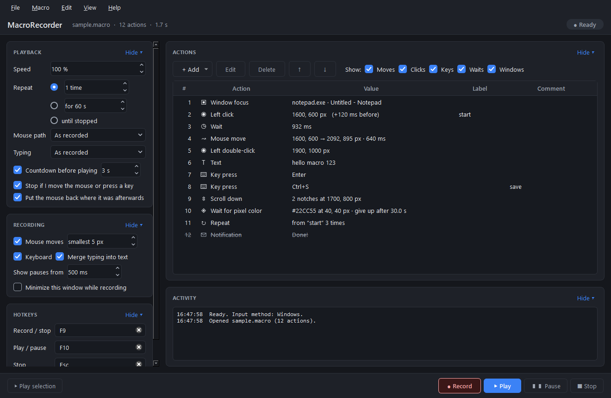
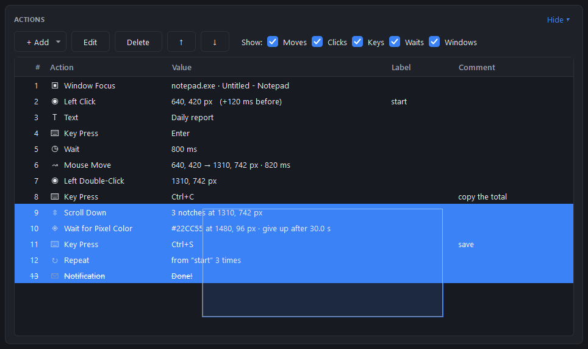
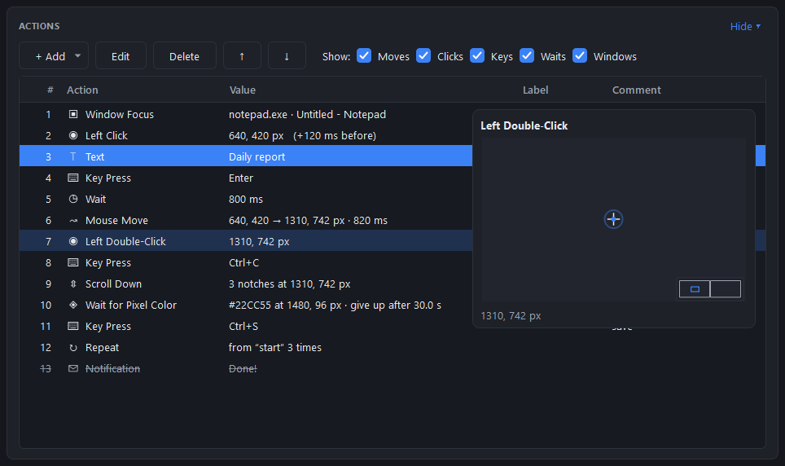
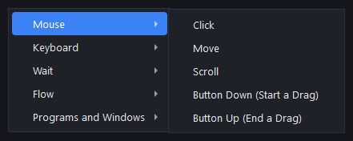
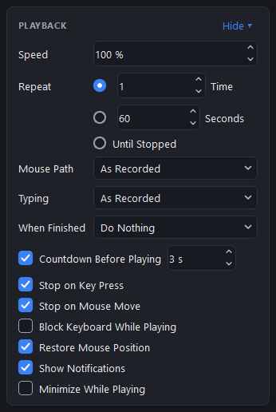
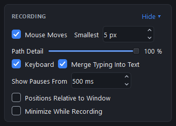
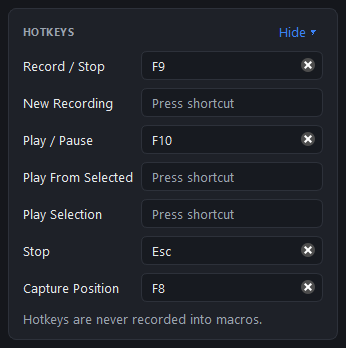

# MacroRecorder

Record what you do with the mouse and keyboard, edit it step by step, and play it back as many times as you like.
Free and open source (GPL-3.0). One file to download: nothing to install.



## What it does

- **Records** mouse moves, clicks, drags, scrolling, key presses, shortcuts and typed text, plus which window
  you were working in.
- **Shows each step in a list** you can edit, reorder, copy, disable, undo and redo.
- **Plays it back exactly:** clicks land on the same pixel, and the timing is kept. Faster, slower, or repeated.
- **Previews a step** when you point at it: a mouse move's path, or the spot where a click lands.
- **Global hotkeys** work from any program: **F9** records, **F10** plays, **Esc** stops.
- **Safe to stop:** moving the mouse or pressing a key stops playback, and held buttons or keys are always
  released.
- **38 color themes**, including popular editor schemes (see the credits below).

## Download

Get the latest version from the [Releases page](https://github.com/cincottash/MacroRecorder/releases/latest):

| System | File |
|---|---|
| Windows 10 or 11 | `MacroRecorder.exe`: download and double-click. |
| Linux (x86-64) | `MacroRecorder-x86_64.AppImage`: download, make it executable (`chmod +x MacroRecorder-x86_64.AppImage`), run it. |

Windows may warn that the app is from an unknown publisher (it isn't code-signed). Choose **More info → Run
anyway**. Programs that watch the keyboard and mouse sometimes get flagged by antivirus tools for the same reason.
On Linux, see [Linux setup](#linux-setup).

## First run

The app asks where to keep its settings. Pick any folder, or choose **Don't Keep App Data** to start fresh every
time. While that choice is on, a **Settings Not Kept** link shows at the top of the window; click it to pick a
folder. You can change this at any time in **File ▸ Settings ▸ Change App Data Folder…**.

Your macros are saved wherever you choose when you save them.

## Record and play

| To | Do this |
|---|---|
| **Record** | Press **● Record** (or **F9**), do what you want to automate, then press **Esc** or **F9**. |
| **Play** | Press **▶ Play** (or **F10**). **F10** pauses and resumes; **Esc** or **■ Stop** stops. |
| **Play part of it** | Select some steps and press **▶ Play Selection**. The **Macro** menu can also play from the selected step, up to it, or only that step. |
| **Record more** | **Macro ▸ Record After Selected Step** adds the new steps there; **Macro ▸ New Recording** starts over. |

Clicks on the app's own window and the hotkeys themselves are never recorded.

## The step list

### Selecting steps



Click a step, Ctrl+click to add one, Shift+click for a range. Or press anywhere in the list, including the empty
space below the steps, and drag a box over the steps you want, as in File Explorer. Hold Ctrl to add to the
selection; drag past the top or bottom edge to scroll. Clicking empty space clears the selection.

### Previewing a step



The row under the pointer is lightly highlighted (a selected row more strongly). Point at a mouse step, anywhere
on its row. A small animated picture appears beside the list: a move's path
traced at its recorded speed (as in the picture at the top), or the spot where it clicks or scrolls, with a map
of your screens in the corner. Turn it off with **View ▸ Preview Steps on Hover**.

### Editing a step


Double-click a step (or press **F2**) to change it. Double-click the **Label** or **Comment** column to type
there.

**Use Mouse Position…** fills in the position from the screen. While an editor is open, **F8** captures the spot
under the pointer (and its color, for Wait for Pixel Color).

**Show:** above the list hides kinds of steps (hidden steps still play). The selected step's position is marked
on the screen with a red ring (**View ▸ Mark Selected Step on Screen**).

<br clear="right">

### Adding steps by hand

**+ Add** inserts a step after the selected one.



| Group | Steps |
|---|---|
| Mouse | Click, Move, Scroll, Button Down / Up (drags) |
| Keyboard | Key Press / Shortcut, Text, Key Down / Up |
| Wait | Wait, Wait for Pixel Color, Wait for Key, Wait for File |
| Flow | Repeat, Go To, Run Another Macro |
| Programs and Windows | Window Focus, Run Program, Notification, Message Box, Beep |

### Repeating part of a macro


Give the first step of the part a **Label** (for example `start`), then add **Flow ▸ Repeat** after the part and
pick that label. "3 times" plays the part three times in total.

<br clear="right">

### Keyboard shortcuts

| Keys | What they do |
|---|---|
| **F2** (or double-click) | Edit the selected step |
| **Delete** | Delete the selected steps |
| **Ctrl+E** | Enable or disable the selected steps |
| **Alt+↑** / **Alt+↓** | Move the selected steps up or down |
| **Ctrl+X** / **Ctrl+C** / **Ctrl+V** | Cut, copy, paste |
| **Ctrl+A** | Select all steps |
| **Ctrl+Z** / **Ctrl+Y** | Undo, redo |
| **Ctrl+H** | Find and Replace |

## Options

Each card folds to its title with **Hide ▾** / **Show ▴**.

### Playback



- **Speed:** 100 % is the recorded speed, 200 % twice as fast.
- **Repeat:** a number of times, for a number of seconds, or until stopped.
- **Mouse Path:** *As Recorded*, *Straight Line*, *Smooth Curve*, or *Human-Like* (wobbles and slows near the
  target, for programs that notice robotic movement).
- **Typing:** *As Recorded* keeps the rhythm (some programs miss keys typed too fast); *Instant* types
  everything at once.
- **When Finished:** close the app, lock, sleep, log off, restart or shut down. Only after the macro finishes on
  its own, and after a 30-second countdown you can cancel.
- **Countdown Before Playing:** a few seconds to switch to the right window.
- **Stop on Key Press**, **Stop on Mouse Move**.
- **Block Keyboard While Playing** (Windows): keys don't reach other programs; the Stop and Pause hotkeys still
  work.
- **Restore Mouse Position**, **Show Notifications**, **Minimize While Playing**.

<br clear="right">

### Recording



- **Mouse Moves** on or off, and the **Smallest** movement kept (in pixels).
- **Path Detail:** 100 % keeps every point; lower leaves out points that barely change a path's shape.
- **Keyboard** on or off; **Merge Typing Into Text** turns typed characters into one Text step.
- **Show Pauses From:** longer pauses become their own *Wait* steps. Shorter ones stay with the next step
  ("+120 ms before"), so timing stays exact.
- **Positions Relative to Window:** the macro still works when the window has moved.
- **Minimize While Recording.**

<br clear="right">

### Hotkeys



Click a box and press the key you want, or clear it. Hotkeys work from any program.

If another program already uses a key, or two hotkeys share one, the card says so.

**Stop** is active only while recording or playing, and **Capture Position** only while a step's editor is open,
so those keys work normally the rest of the time.

<br clear="right">

### Themes


**View ▸ Theme** has 24 dark and 14 light themes, or **Match Operating System**.

Hover over a theme to preview it; click to keep it.

<br clear="right">

#### Your own themes


**View ▸ Theme ▸ Import Theme…** adds a theme from a single `.json` file. It appears under **Custom Themes**
and stays there after the app closes. Importing a file with the same theme name again updates it.

Two kinds of file work:

- **A VS Code color theme**, as it comes (comments and all). Its editor, sidebar and button colors are used.
- **A MacroRecorder theme.** **Export Current Theme…** saves the theme in use as one; change its colors and
  import it.

<br clear="right">

A MacroRecorder theme needs only `bg` (the background) and `text`; any color left out is worked out from those:

```json
{
  "name": "Ocean",
  "colors": { "bg": "#0B2030", "text": "#E0F0FF", "accent": "#20A0C0" }
}
```

<details>
<summary><b>Every color a theme can set</b></summary>

| Name | Used for |
|---|---|
| `bg` | The window's background |
| `card` | The cards, menus and the step list |
| `border` | Lines around cards, boxes and menus |
| `text`, `muted` | Text, and quieter text (hints, card titles) |
| `accent`, `accent_hover`, `accent_text` | Selected rows, the Play button and links; the button under the pointer; text on the accent |
| `input` | Text boxes and number boxes |
| `log_bg` | The Activity log |
| `track` | Disabled buttons, the status label while idle, and the menu bar item under the pointer |
| `ok`, `ok_bg` | "Playing" and other good news |
| `warn`, `warn_bg`, `warn_border` | Warnings |
| `err`, `err_bg` | "Recording", errors |

Colors are written `#RRGGBB`. A theme with the same name as a built-in one gets "(Imported)" added to its name.
If the text would be hard to read on the background, the Activity log says so.

</details>

**Remove Custom Theme** takes an imported theme off the list.

### Window opacity

**View ▸ Window Opacity** makes the whole window see-through (100 % down to 50 %), so a program behind it stays
visible, for example with **Always on Top**. Two options lower it to 50 % only some of the time:
**See-Through While Recording or Playing** and **See-Through When Inactive** (while another program is in
front). On Linux this needs a desktop with a compositor (most have one).

### Activity

The log at the bottom right says what happened and when. **View ▸ Detailed Activity Log** also lists every step
played.

## Reference

<details>
<summary><b>Menus</b></summary>

- **File**: New, Open, Open Recent, Save, Save As, Export to CSV, Copy Command Line (plays the saved macro and
  closes; for a shortcut or Windows Task Scheduler), Settings, Quit.
  - **Settings**: Change App Data Folder, Reset Settings to Defaults, Confirm Before Deleting Steps, Start
    Minimized, Start at Login, and on Windows: Send Keys as Scan Codes (for games that ignore normal key presses),
    Restart as Administrator (needed to control programs running as administrator).
- **Macro**: Record, Record After Selected Step, New Recording, Play, Play Selection, Play From Selected Step,
  Play Up to Selected Step, Play This Step Only, Pause / Resume, Stop, Add Action, Clean Up (merges back-to-back
  waits and moves).
- **Edit**: Undo, Redo, Cut, Copy, Paste, Delete, Select All, Edit Step, Enable / Disable, Move Up / Down,
  Combine Into Click or Key Press (a button down + up, or key down + up), Find and Replace.
- **View**: Theme (including Import Theme, Export Current Theme and Remove Custom Theme), Show Activity Log, Detailed Activity Log (also lists every step played), Always on Top, Window Opacity, Mark
  Selected Step on Screen, Preview Steps on Hover, Reset View Options.
- **Help**: Project Website, Open App Data Folder, Report a Problem, About.

</details>

<details>
<summary><b>Command line</b></summary>

```
MacroRecorder.exe [file] [--play] [--repeat N] [--quit] [--minimized] [--data-folder FOLDER]
```

| Option | What it does |
|---|---|
| `file` | Opens this macro. |
| `--play` | Plays it right away (no countdown). |
| `--repeat N` | Plays it N times (with `--play`). |
| `--quit` | Closes the app when playback ends (with `--play`). Handy for Windows Task Scheduler. |
| `--minimized` | Starts minimized. |
| `--record FILE` | Starts minimized and recording at once; when you stop (Stop hotkey, Esc by default), saves to FILE and quits. |
| `--data-folder FOLDER` | Keeps settings in FOLDER for this run, for example to run from a USB stick. |
| `--screenshot FILE.png` | Saves a picture of the window and exits (used by the automatic build checks). |

Example: `MacroRecorder.exe "C:\path\to\daily-report.macro" --play --repeat 3 --quit`

</details>

<details>
<summary><b>Macro files</b></summary>

Macros are saved as `.macro` files: plain JSON you can read, compare and fix in any text editor. Each step is
one object with a `type` (`mouse_click`, `text`, `wait`, …) and its values. Positions are screen pixels, or
pixels from the window's corner for steps recorded with **Positions Relative to Window** (those carry
`"relative_to_window": true`).

</details>

### Linux setup

The app checks your session when it starts and uses the best method available; the Activity log says which one.

| Session | Recording | Playback |
|---|---|---|
| **X11** ("Xorg" at the login screen) | every program | every program |
| **Wayland**, with access to `/dev/uinput` | programs running through XWayland | every program |
| **Wayland**, without that access | programs running through XWayland | programs running through XWayland |

**For recording, log in with an X11 session** (most distributions offer "Xorg" or "X11" on the login screen's
settings button): Wayland doesn't let one program watch the mouse and keyboard of others.

<details>
<summary><b>Playing back into every program on Wayland</b></summary>

Give your user access to `/dev/uinput` once, then log out and back in:

```
echo 'KERNEL=="uinput", GROUP="input", MODE="0660", OPTIONS+="static_node=uinput"' | sudo tee /etc/udev/rules.d/60-macrorecorder-uinput.rules
sudo usermod -aG input "$USER"
sudo udevadm control --reload-rules && sudo udevadm trigger
```

The first line lets members of the `input` group use `/dev/uinput`; the second adds you to that group. On Wayland,
playback through `/dev/uinput` types plain US-keyboard characters, and "Window Focus", "Wait for Pixel Color",
"Wait for Key" and positions relative to a window aren't available (Wayland keeps that information private); the
Activity log says when a step was skipped. Blocking the keyboard during playback is Windows-only.

</details>

### For developers

<details>
<summary><b>Building from source</b></summary>

The app is C++20 with Qt 6 (6.5 or newer) and CMake.

**Windows** (with [MSYS2](https://www.msys2.org), UCRT64 environment):

```
pacman -S mingw-w64-ucrt-x86_64-gcc mingw-w64-ucrt-x86_64-cmake mingw-w64-ucrt-x86_64-ninja ^
          mingw-w64-ucrt-x86_64-pkgconf mingw-w64-ucrt-x86_64-qt6-base mingw-w64-ucrt-x86_64-qt6-svg
cmake -S . -B build -G Ninja -DCMAKE_BUILD_TYPE=Release
cmake --build build
```

For the single self-contained exe, also install `mingw-w64-ucrt-x86_64-qt6-static`, plus the libraries it links
(`libtiff libwebp harfbuzz freetype libpng zlib pcre2 openssl libb2 brotli bzip2`, each with the
`mingw-w64-ucrt-x86_64-` prefix), and configure with
`-DSTATIC_BUILD=ON -DCMAKE_PREFIX_PATH=/ucrt64/qt6-static`.

**Linux:** install Qt 6 (with the SVG module), CMake, Ninja and the X11 development files (`libx11-dev
libxtst-dev` on Debian and Ubuntu), then run the same two `cmake` commands.

**Changing the icon:** edit `resources/icon.svg`, then rebuild `packaging/icon.ico` with the small tool in
`packaging/make_icon.cpp` (build it against Qt Gui and Qt Svg, then run
`make_icon resources/icon.svg packaging/icon.ico`).

</details>

<details>
<summary><b>Automatic releases</b></summary>

GitHub Actions (`.github/workflows/build-apps.yml`) builds the Windows exe and the Linux AppImage and checks that
both start. On Linux it also records and plays back for real on a virtual X11 display (`.github/ci/x11_check.sh`).

- **Pull requests:** the built files are kept with the run for 14 days (open the run, then **Artifacts**).
- **Every merge into `main`:** a new release is published with both files, numbered automatically
  (v1.0.1 → v1.0.2). Put `[minor]` or `[major]` in the pull request's **title** for v1.1.0 or v2.0.0.

</details>

<details>
<summary><b>Code layout</b></summary>

| Folder | What's there |
|---|---|
| `src/core` | Macro steps and file format (`Action`), recording logic (`Recorder`), playback (`Player`), mouse paths (`Paths`). No operating-system code. |
| `src/platform` | The operating-system layer: `win/` (hooks, input, hotkeys, windows), `linux/` (X11 with XRecord and XTest, `/dev/uinput` for Wayland, and the choice between them). |
| `src/app` | The window, cards, menus, step editor, themes, settings and app data folder. |
| `resources` | Icon and small images used by the themes. |
| `packaging` | Windows icon and version info, the icon tool, the Linux desktop entry. |

</details>

## License and credits

Copyright © 2026 cincottash. Licensed under the [GNU General Public License v3.0](LICENSE).

Built with [Qt](https://www.qt.io) (LGPL-3.0).

The Dark Themes and Light Themes use colors from these open-source editor color schemes, adjusted for
readability as app themes: Nord, Dracula, Solarized, Gruvbox, One Dark / One Light, Tokyo Night, Catppuccin
(Mocha, Macchiato, Frappé, Latte), Rosé Pine (main, Moon, Dawn), Everforest, Kanagawa (Wave, Lotus), Ayu (Dark,
Mirage, Light), Palenight, Night Owl, Cobalt2, Synthwave '84, Tomorrow (Night and Day), Monokai and Zenburn.
Thanks to their authors.
