# MacroRecorder

Record what you do with the mouse and keyboard, edit it step by step, and play it back as many times as you like.
Free and open source (GPL-3.0). One file to download: nothing to install.

> [!NOTE]
> **Windows** is the main platform: tested in depth, on real desktops. **The Linux version is experimental**: it
> starts and works on a plain X11 desktop, but it has had little testing on real machines, and on **Wayland**
> (the default on most current distributions) recording other programs doesn't work. See
> [Linux (experimental)](#linux-experimental).


## What it does

- **Records** mouse moves, clicks, drags, scrolling, key presses, shortcuts and typed text, plus which window
  you were working in.
- **Shows each step in a list** you can edit, reorder, copy, disable, undo and redo.
- **Plays it back exactly:** clicks land on the same pixel, and the timing is kept. Faster, slower, or repeated.
- **Previews a step** when you point at it: a mouse move's path, or the spot where a click lands.
- **Global hotkeys** work from any program: **F9** records, **F10** plays, **Esc** stops.
- **Decides as it plays:** variables, If / Else, loops that end, calculations, random waits and values, and
  questions that ask you for a text while playing.
- **Sees the screen:** finds a picture or a word on the screen, waits for it and clicks it wherever it is, and
  reads text into a variable. Clicks recorded with **Find Clicked Buttons by Picture** still hit their button
  after a window has moved.
- **Runs without opening it:** a hotkey for each macro, schedules, and desktop shortcuts.
- **Ask AI** steps, answered by an AI model on your own PC (free, with LM Studio).
- **Safe to stop:** moving the mouse or pressing a key stops playback, and held buttons or keys are always
  released.
- **English or Spanish (Español):** chosen at the first start, changed any time in **File ▸ Settings ▸ Language**.
- **38 color themes**, including popular editor schemes (see the credits below).

## Download

Get the latest version from the [Releases page](https://github.com/cincottash/MacroRecorder/releases/latest):

| System | File |
|---|---|
| Windows 10 or 11 | `MacroRecorder.exe`: download and double-click. |
| Linux (x86-64), **experimental** | `MacroRecorder-x86_64.AppImage`: download, make it executable (`chmod +x MacroRecorder-x86_64.AppImage`), run it. Read [Linux (experimental)](#linux-experimental) first. |

Windows may warn that the app is from an unknown publisher (it isn't code-signed). Choose **More info → Run
anyway**. Programs that watch the keyboard and mouse sometimes get flagged by antivirus tools for the same reason.
On Linux, see [Linux (experimental)](#linux-experimental).

## First run

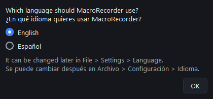

The app first asks which language to use: **English** or **Español** (Spanish). The answer is kept with the other
settings; change it later in **File ▸ Settings ▸ Language** (the app offers to restart in the new language).

<br clear="right">

Then it asks where to keep its settings. It suggests the usual place for app data (`%LOCALAPPDATA%\MacroRecorder`
on Windows, `~/.local/share/MacroRecorder` on Linux); pick any folder, or choose **Don't Keep App Data** to start
fresh every time. While that choice is on, a **Settings Not Kept** link shows at the top of the window; click it to pick a
folder. You can change this at any time in **File ▸ Settings ▸ Change App Data Folder…**. To go back to how the
app was when first installed, use **File ▸ Settings ▸ Start Over…**: every setting returns to its default and these
questions show again.

Your macros are saved wherever you choose when you save them.

## Record and play

| To | Do this |
|---|---|
| **Record** | Press **● Record** (or **F9**), do what you want to automate, then press **Esc** or **F9**. |
| **Play** | Press **▶ Play** (or **F10**). **F10** pauses and resumes; **Esc** or **■ Stop** stops. |
| **Play part of it** | Select some steps and press **▶ Play Selection**. The **Macro** menu can also play from the selected step, up to it, or only that step. |
| **Record more** | **Macro ▸ Record After Selected Step** adds the new steps there; **Macro ▸ New Recording** starts over. |
| **Play without opening it** | Give a saved macro its own hotkey, a schedule or a desktop shortcut (see [Playing macros without opening them](#playing-macros-without-opening-them)). |

Clicks on the app's own window and the hotkeys themselves are never recorded. A macro started by a hotkey such
as Ctrl+Alt+1 waits until you let go of Ctrl and Alt, so its first keys aren't taken as shortcuts.

## The step list

### Selecting steps


Click a step, Ctrl+click to add one, Shift+click for a range. Or press anywhere in the list, including the empty
space below the steps, and drag a box over the steps you want, as in File Explorer. Hold Ctrl to add to the
selection; drag past the top or bottom edge to scroll. Clicking empty space clears the selection. Right-click a
step for its commands (edit, play from it, cut, copy, group…).

### Previewing a step


The row under the pointer is lightly highlighted (a selected row more strongly). Point at a mouse step, anywhere
on its row. A small animated picture appears beside the list: a move's path
traced at its recorded speed (as in the picture at the top), or the spot where it clicks or scrolls, with a map
of your screens in the corner. Turn it off with **View ▸ Preview Steps on Hover**.

### Editing a step

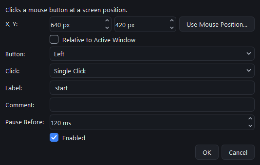

Double-click a step (or press **F2**) to change it. Double-click the **Label** or **Comment** column to type
there.

**Use Mouse Position…** fills in the position from the screen. While an editor is open, **F8** captures the spot
under the pointer (and its color, for Wait for Pixel Color).

The **Show** drop-down above the list hides kinds of steps: moves, clicks, keys, waits, windows (hidden steps
still play). Its menu stays open while you tick several. The selected step's position is marked
on the screen with a red ring (**View ▸ Mark Selected Step on Screen**).

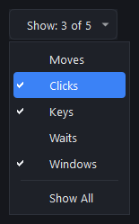

<br clear="right">

### Adding steps by hand

**+ Add** inserts a step after the selected one.


| Group | Steps |
|---|---|
| Mouse | Click, Click Image, Click Text, Move, Scroll, Button Down / Up (drags) |
| Keyboard | Key Press / Shortcut, Text, Key Down / Up |
| Wait | Wait (a fixed or a random time), Wait for Image, Wait for Text, Wait for Pixel Color, Wait for Key, Wait for File, Ask for Text |
| Flow | Repeat, Go To (with an optional condition), Run Another Macro, Group |
| Variables and Conditions | Set Variable, If, Else, End If, Read Text From Screen, Ask AI |
| Programs and Windows | Window Focus, Move / Resize Window, Run Program, Notification, Message Box, Beep, Find Image, Save Screenshot, Set Clipboard |

### Repeating part of a macro

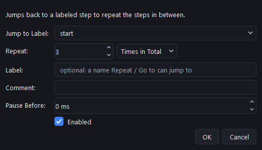

Give the first step of the part a **Label** (for example `start`), then add **Flow ▸ Repeat** after the part and
pick that label. "3 times" plays the part three times in total.

<br clear="right">

### Variables, conditions and groups

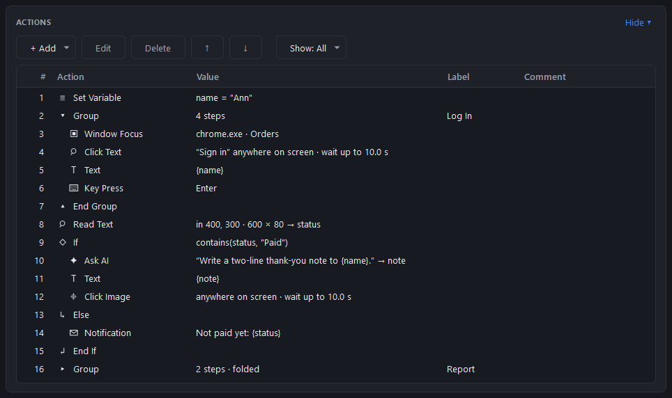

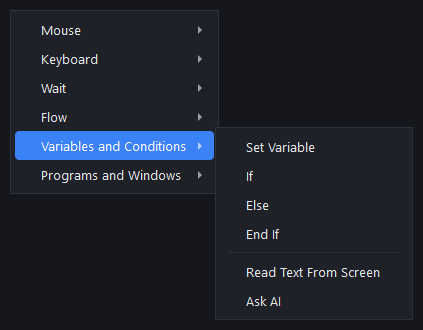

- **Set Variable** gives a name a value: a number, `"some text"`, or a calculation such as `count + 1`,
  `random(1, 10)` or `item("red, green, blue", round)` (the next item each time the macro repeats).
- In any text a step types or shows, **`{name}`** puts in a variable's value and **`{=expression}`** a
  calculation, for example `Order {=count * 10}`.
- **If … Else … End If** plays steps only when a condition is true: `count < 10`, `answer = "yes"`,
  `found` (after a Find step), `contains(status, "Paid")`. **Go To** can take a condition too, which makes a loop
  that ends.
- **Ask for Text** asks a question while playing and keeps the answer; **Wait** can wait a random time between
  two values.
- **Groups:** select steps and press **Ctrl+G** to give them a name. Click a group's arrow (or press ← / →) to
  fold it away; a disabled group skips all its steps.

<details>
<summary><b>Everything a value or a condition can use</b></summary>

Numbers (`2.5`), text in quotes, variables, `true` and `false`. `+ - * / %` calculate; `+` also joins text and `&`
always joins. Comparisons: `=` (or `==`), `!=` (or `<>`), `<`, `<=`, `>`, `>=` (text is compared without regard
to case), combined with `and`, `or`, `not`. Ready-made variables: `round` (which time through the macro),
`found`, `found_x`, `found_y` (after Find Image or Find Text).

| Function | Gives |
|---|---|
| `random(1, 10)`, `pick("a, b, c")` | a whole number from 1 to 10; one item at random |
| `item(list, n)`, `count(list)` | the nth item (starting over after the last); how many items |
| `line("C:\names.txt", n)`, `lines(file)` | the nth line of a text file; how many lines |
| `round(x, digits)`, `floor`, `ceil`, `abs`, `min`, `max` | numbers |
| `len`, `upper`, `lower`, `trim`, `left(t, n)`, `right(t, n)`, `mid(t, start, n)` | text |
| `find(t, part)`, `contains(t, part)`, `replace(t, old, new)` | searching and replacing in text |
| `number(t)`, `text(x)`, `if(condition, a, b)` | conversions; a choice |
| `exists(file)`, `now("yyyy-MM-dd HH:mm")`, `clipboard()` | a file check; the date and time; the clipboard's text |

The **Functions…** button in the editors lists them too.

</details>

### Finding things on the screen

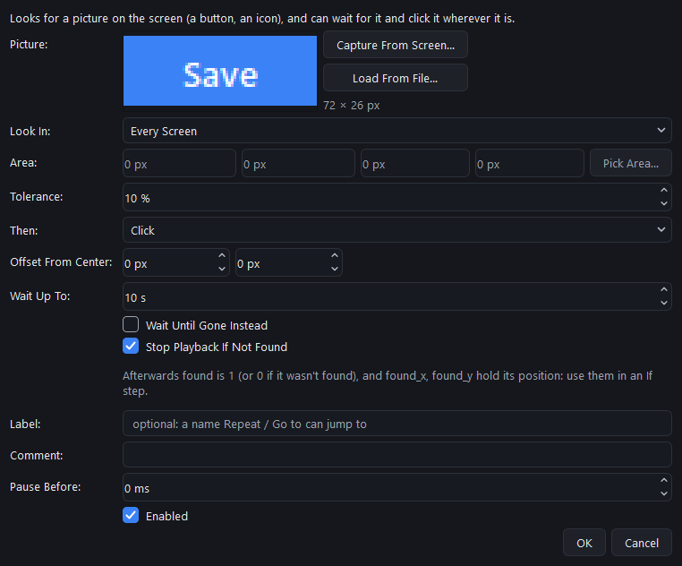

- **Find Image / Click Image / Wait for Image:** **Capture From Screen…** shows a still picture of your screens;
  drag a box around a button or an icon. Playing, the step looks for that picture (in an area, or everywhere),
  can wait for it, and moves to it or clicks it wherever it is now.
- **Find Text / Click Text / Wait for Text / Read Text From Screen** read the screen with Windows' own text
  recognition: click a word or phrase, wait until it appears, or keep everything an area shows in a variable.
- **Find Clicked Buttons by Picture** (Recording card): each recorded click also keeps a small picture of what
  it landed on, and when playing it clicks that picture wherever it is.
- **Move / Resize Window** puts a program's window at a position and size, or maximizes, minimizes or restores
  it. **Save Screenshot** saves the screen or an area as a PNG file.

<br clear="right">

### Keyboard shortcuts

| Keys | What they do |
|---|---|
| **F2** (or double-click) | Edit the selected step |
| **Delete** | Delete the selected steps |
| **Ctrl+E** | Enable or disable the selected steps |
| **Alt+↑** / **Alt+↓** | Move the selected steps up or down |
| **Ctrl+X** / **Ctrl+C** / **Ctrl+V** | Cut, copy, paste |
| **Ctrl+A** | Select all steps |
| **Ctrl+Z** / **Ctrl+Y** | Undo, redo |
| **Ctrl+H** | Find and Replace |
| **Ctrl+G** / **Ctrl+Shift+G** | Group the selected steps; ungroup |
| **←** / **→** on a group | Fold it; show its steps |

## Playing macros without opening them

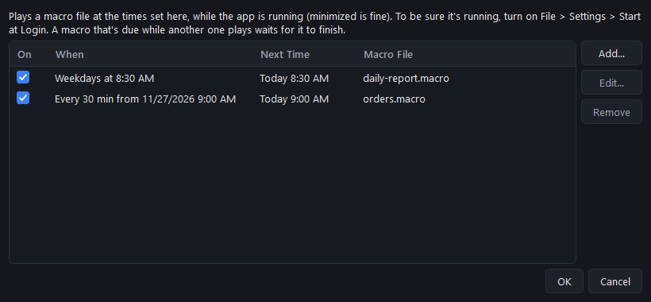

- **Macro ▸ Macro Hotkeys…:** a hotkey for a saved macro plays it from any program, without opening it.
  Pressing it again while that macro plays stops it.
- **Macro ▸ Schedules…:** once, every day, on chosen days, or every few minutes. The app must be running
  (minimized is fine; **File ▸ Settings ▸ Start at Login** makes sure of it). A schedule that comes due while
  something else plays waits for it. To set the time, click the calendar button beside **Time** and pick the
  day, hour and minute, or type them in the boxes.
- **File ▸ Create Desktop Shortcut…:** double-click the shortcut to play the macro. If the app is already
  running, the macro plays there; otherwise the app starts, plays it and closes.

<br clear="right">

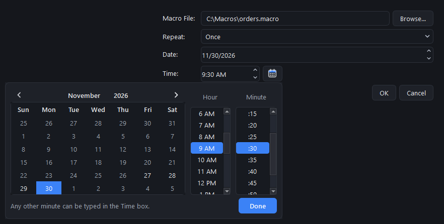

## Ask AI

**Variables and Conditions ▸ Ask AI** sends a prompt (with variables in it, for example
`Write a short reply to: {=clipboard()}`) to an AI model and keeps the answer in a variable, ready for a Text
step or an If. By default it asks [LM Studio](https://lmstudio.ai)'s local server on your own PC: free and
private. Load a model in LM Studio and start its server in its Developer tab. **File ▸ Settings ▸ AI Server…**
can point it at any other server that speaks the OpenAI API (Ollama: `http://localhost:11434/v1`).

## Options

Each card folds to its title with **Hide ▾** / **Show ▴**.

### Playback


- **Speed:** 100 % is the recorded speed, 200 % twice as fast.
- **Repeat:** a number of times, for a number of seconds, or until stopped.
- **Mouse Path:** *As Recorded*, *Straight Line*, *Smooth Curve*, or *Human-Like* (wobbles and slows near the
  target, for programs that notice robotic movement).
- **Typing:** *As Recorded* keeps the rhythm (some programs miss keys typed too fast); *Instant* types
  everything at once.
- **When Finished:** close the app, lock, sleep, log off, restart or shut down. Only after the macro finishes on
  its own, and after a 30-second countdown you can cancel.
- **Countdown Before Playing:** a few seconds to switch to the right window.
- **Stop on Key Press**, **Stop on Mouse Move**.
- **Block Keyboard While Playing** (Windows): keys don't reach other programs; the Stop and Pause hotkeys still
  work.
- **Restore Mouse Position**, **Show Notifications**, **Minimize While Playing**.

<br clear="right">

### Recording


- **Mouse Moves** on or off, and the **Smallest** movement kept (in pixels).
- **Path Detail:** 100 % keeps every point; lower leaves out points that barely change a path's shape.
- **Keyboard** on or off; **Merge Typing Into Text** turns typed characters into one Text step.
- **Show Pauses From:** longer pauses become their own *Wait* steps. Shorter ones stay with the next step
  ("+120 ms before"), so timing stays exact.
- **Positions Relative to Window:** the macro still works when the window has moved.
- **Find Clicked Buttons by Picture:** each click also keeps a small picture of what it landed on; playing, the
  click finds that picture first, so it still hits its button when a window has moved or a list has scrolled.
- **Minimize While Recording.**

<br clear="right">

### Hotkeys


Click a box and press the key you want, or clear it. Hotkeys work from any program.

If another program already uses a key, or two hotkeys share one, the card says so.

**Stop** is active only while recording or playing, and **Capture Position** only while a step's editor is open,
so those keys work normally the rest of the time.

<br clear="right">

### Themes

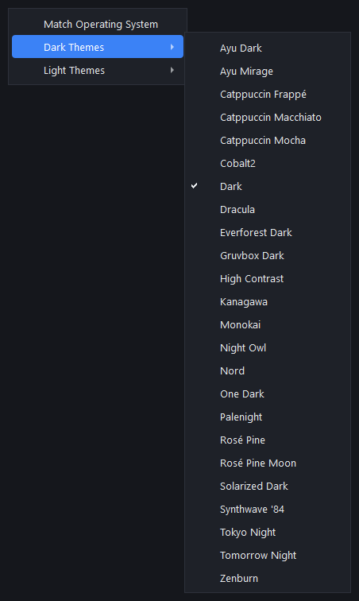

**View ▸ Theme** has 24 dark and 14 light themes, or **Match Operating System**.

Hover over a theme to preview it; click to keep it.

<br clear="right">

#### Your own themes

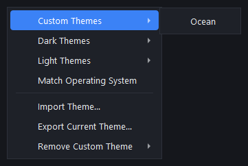

**View ▸ Theme ▸ Import Theme…** adds a theme from a single `.json` file. It appears under **Custom Themes**
and stays there after the app closes. Importing a file with the same theme name again updates it.

Two kinds of file work:

- **A VS Code color theme**, as it comes (comments and all). Its editor, sidebar and button colors are used.
- **A MacroRecorder theme.** **Export Current Theme…** saves the theme in use as one; change its colors and
  import it.

<br clear="right">

A MacroRecorder theme needs only `bg` (the background) and `text`; any color left out is worked out from those:

```json
{
  "name": "Ocean",
  "colors": { "bg": "#0B2030", "text": "#E0F0FF", "accent": "#20A0C0" }
}
```

<details>
<summary><b>Every color a theme can set</b></summary>

| Name | Used for |
|---|---|
| `bg` | The window's background |
| `card` | The cards, menus and the step list |
| `border` | Lines around cards, boxes and menus |
| `text`, `muted` | Text, and quieter text (hints, card titles) |
| `accent`, `accent_hover`, `accent_text` | Selected rows, the Play button and links; the button under the pointer; text on the accent |
| `input` | Text boxes and number boxes |
| `log_bg` | The Activity log |
| `track` | Disabled buttons, the status label while idle, and the menu bar item under the pointer |
| `ok`, `ok_bg` | "Playing" and other good news |
| `warn`, `warn_bg`, `warn_border` | Warnings |
| `err`, `err_bg` | "Recording", errors |

Colors are written `#RRGGBB`. A theme with the same name as a built-in one gets "(Imported)" added to its name.
If the text would be hard to read on the background, the Activity log says so.

</details>

**Remove Custom Theme** takes an imported theme off the list.

### Window opacity

**View ▸ Window Opacity** makes the whole window see-through, so a program behind it stays visible (handy with
**Always on Top**). Drag **Opacity** and the window changes as you go; it keeps that level until you change it.
The whole app follows it: menus, drop-down lists, dialogs, tooltips and the on-screen position marker. While the
window is see-through, opening and saving files uses the app's own file dialog instead of the Windows one, which
can't be see-through.

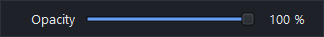

On Linux it depends on the desktop and often does nothing, especially on Wayland.

### Activity

The log at the bottom right says what happened and when. **View ▸ Detailed Activity Log** also lists every step
played.

## Reference

<details>
<summary><b>Menus</b></summary>

- **File**: New, Open, Open Recent, Save, Save As, Export to CSV (separated the way your region's spreadsheets
  expect: commas in the US, semicolons in most of Europe), Create Desktop Shortcut, Copy Command Line (plays the
  saved macro and closes; for Windows Task Scheduler), Settings, Quit.
  - **Settings**: Language (English or Español; the app restarts in it), Change App Data Folder, Reset Settings to Defaults, AI Server
    (for Ask AI steps), Start Over (every setting back to its default, then the app restarts and asks for the language and the
    settings folder again; your saved macros aren't touched), Confirm Before Deleting Steps, Start
    Minimized, Start at Login, and on Windows: Send Keys as Scan Codes (for games that ignore normal key presses),
    Restart as Administrator (needed to control programs running as administrator).
- **Macro**: Record, Record After Selected Step, New Recording, Play, Play Selection, Play From Selected Step,
  Play Up to Selected Step, Play This Step Only, Pause / Resume, Stop, Add Action, Clean Up (merges back-to-back
  waits and moves), Macro Hotkeys, Schedules.
- **Edit**: Undo, Redo, Cut, Copy, Paste, Delete, Select All, Edit Step, Enable / Disable, Move Up / Down,
  Combine Into Click or Key Press (a button down + up, or key down + up), Find and Replace, Group Selected Steps,
  Ungroup, Fold All Groups, Unfold All Groups.
- **View**: Theme (including Import Theme, Export Current Theme and Remove Custom Theme), Show Activity Log, Detailed Activity Log (also lists every step played), Always on Top, Window Opacity, Mark
  Selected Step on Screen, Preview Steps on Hover, Reset View Options.
- **Help**: Project Website, Open App Data Folder, Report a Problem, Check for Updates (asks GitHub for the
  latest release; nothing is downloaded by itself), About.

</details>

<details>
<summary><b>Command line</b></summary>

```
MacroRecorder.exe [file] [--play] [--repeat N] [--quit] [--minimized] [--data-folder FOLDER] [--language en|es]
```

| Option | What it does |
|---|---|
| `file` | Opens this macro. |
| `--play` | Plays it right away (no countdown). |
| `--repeat N` | Plays it N times (with `--play`). |
| `--quit` | Closes the app when playback ends (with `--play`). Handy for Windows Task Scheduler. |
| `--minimized` | Starts minimized. |
| `--record FILE` | Starts minimized and recording at once; when you stop (Stop hotkey, Esc by default), saves to FILE and quits. |
| `--data-folder FOLDER` | Keeps settings in FOLDER for this run, for example to run from a USB stick. |
| `--language en` or `es` | Shows the app in English or Spanish for this run only (the saved choice stays as it is). |
| `--screenshot FILE.png` | Saves a picture of the window and exits (used by the automatic build checks). |

Example: `MacroRecorder.exe "C:\path\to\daily-report.macro" --play --repeat 3 --quit`

Only one copy runs at a time (per settings folder): starting the app again hands its file to the copy that's
running, which opens it (or plays it, with `--play`), and the new start closes at once. `--record` always runs
on its own.

</details>

<details>
<summary><b>Macro files</b></summary>

Macros are saved as `.macro` files: plain JSON you can read, compare and fix in any text editor. Each step is
one object with a `type` (`mouse_click`, `text`, `wait`, …) and its values. Positions are screen pixels, or
pixels from the window's corner for steps recorded with **Positions Relative to Window** (those carry
`"relative_to_window": true`).

</details>

<a name="linux-setup"></a>
### Linux (experimental)

> [!WARNING]
> The Linux version has had little testing on real computers. Expect problems, and please
> [report them](https://github.com/cincottash/MacroRecorder/issues) with your distribution, desktop, and whether
> you're on X11 or Wayland (`echo $XDG_SESSION_TYPE` prints it).

**What to expect on Wayland** (the default on most current distributions, for example Ubuntu, Fedora, and KDE
Plasma 6). Wayland doesn't let one program see or control others, so there:

- **Recording other programs doesn't work.** Clicks, moves and typing in most programs aren't recorded; only
  older programs that run through XWayland are.
- **The window you're working in isn't detected**, so Window Focus steps and positions relative to a window
  don't work.
- **Global hotkeys** (F9, F10, Esc) only work while an XWayland program is in front.
- **Window opacity** usually does nothing.
- **Find Image, Find Text, Save Screenshot and Find Clicked Buttons by Picture** see only XWayland windows.
- **Playback** reaches every program only after the one-time setup below; otherwise only XWayland programs.

**For the best results, log in with an X11 session** ("Xorg" or "X11" on the login screen's settings button).
On X11, recording and playback work in every program, but the Linux version is still far less tested than the
Windows one.

**Find Text** steps on Linux need Tesseract (`sudo apt install tesseract-ocr`). **Find Clicked Buttons by
Picture** is Windows-only for now.

**Requirements:** a 64-bit x86 PC with a recent distribution (Ubuntu 22.04 or newer, or the same age). If the
AppImage says it can't load `libfuse.so.2`, install FUSE 2 (`sudo apt install libfuse2t64`, or `libfuse2` on
Ubuntu 22.04), or run it without FUSE: `./MacroRecorder-x86_64.AppImage --appimage-extract-and-run`.

The app checks your session when it starts and uses the best method available; the Activity log says which one.
On Wayland the status at the top right reads **Ready (Wayland: Limited)**, with a **What's Limited?** link to this
section.

| Session | Recording | Playback |
|---|---|---|
| **X11** ("Xorg" at the login screen) | every program | every program |
| **Wayland**, with access to `/dev/uinput` | programs running through XWayland | every program |
| **Wayland**, without that access | programs running through XWayland | programs running through XWayland |

On a Wayland session the app's own window runs through XWayland (it picks that by itself, also where Qt programs
are set to use Wayland). If XWayland is turned off, the app says so and doesn't start.

<details>
<summary><b>Playing back into every program on Wayland</b></summary>

Give your user access to `/dev/uinput` once, then log out and back in:

```
echo 'KERNEL=="uinput", GROUP="input", MODE="0660", OPTIONS+="static_node=uinput"' | sudo tee /etc/udev/rules.d/60-macrorecorder-uinput.rules
sudo usermod -aG input "$USER"
sudo udevadm control --reload-rules && sudo udevadm trigger
```

The first line lets members of the `input` group use `/dev/uinput`; the second adds you to that group. On Wayland,
playback through `/dev/uinput` types plain US-keyboard characters, and "Window Focus", "Wait for Pixel Color",
"Wait for Key" and positions relative to a window aren't available (Wayland keeps that information private); the
Activity log says when a step was skipped. Blocking the keyboard during playback is Windows-only.

</details>

### For developers

<details>
<summary><b>Building from source</b></summary>

The app is C++20 with Qt 6 (6.5 or newer) and CMake.

**Windows** (with [MSYS2](https://www.msys2.org), UCRT64 environment):

```
pacman -S mingw-w64-ucrt-x86_64-gcc mingw-w64-ucrt-x86_64-cmake mingw-w64-ucrt-x86_64-ninja ^
          mingw-w64-ucrt-x86_64-pkgconf mingw-w64-ucrt-x86_64-qt6-base mingw-w64-ucrt-x86_64-qt6-svg
cmake -S . -B build -G Ninja -DCMAKE_BUILD_TYPE=Release
cmake --build build
```

For the single self-contained exe, also install `mingw-w64-ucrt-x86_64-qt6-static`, plus the libraries it links
(`libtiff libwebp harfbuzz freetype libpng zlib pcre2 openssl libb2 brotli bzip2`, each with the
`mingw-w64-ucrt-x86_64-` prefix), and configure with
`-DSTATIC_BUILD=ON -DCMAKE_PREFIX_PATH=/ucrt64/qt6-static`.

**Linux:** install Qt 6 (with the SVG module), CMake, Ninja and the X11 development files (`libx11-dev
libxtst-dev` on Debian and Ubuntu), then run the same two `cmake` commands.

**Changing the icon:** edit `resources/icon.svg`, then rebuild `packaging/icon.ico` with the small tool in
`packaging/make_icon.cpp` (build it against Qt Gui and Qt Svg, then run
`make_icon resources/icon.svg packaging/icon.ico`).

</details>

<details>
<summary><b>Automatic releases</b></summary>

GitHub Actions (`.github/workflows/build-apps.yml`) builds the Windows exe and the Linux AppImage and checks that
both start. On Linux it also records and plays back for real on a virtual X11 display (`.github/ci/x11_check.sh`).

- **Pull requests:** the built files are kept with the run for 14 days (open the run, then **Artifacts**).
- **Every merge into `main`:** a new release is published with both files, numbered automatically
  (v1.0.1 → v1.0.2). Put `[minor]` or `[major]` in the pull request's **title** for v1.1.0 or v2.0.0.

</details>

<details>
<summary><b>Code layout</b></summary>

| Folder | What's there |
|---|---|
| `src/core` | Macro steps and file format (`Action`), recording logic (`Recorder`), playback (`Player`), mouse paths (`Paths`), variables and expressions (`Expr`), finding pictures and phrases on the screen (`ImageFind`). No operating-system code. |
| `src/platform` | The operating-system layer: `win/` (hooks, input, hotkeys, windows, screen pictures, text recognition in `WinOcr`), `linux/` (X11 with XRecord and XTest, `/dev/uinput` for Wayland, and the choice between them). |
| `src/app` | The window, cards, menus, step editor, themes, settings and app data folder; Macro Hotkeys and Schedules (`AutoRunDialogs`); the screen-area picker (`ScreenPicker`); the language choice (`Language`). |
| `src/app/i18n` | The translations: `es.json` holds every English text the app shows with its Spanish. Text in the code goes through `T("…")` (`src/core/Tr.h`); text without an entry shows in English. |
| `resources` | Icon and small images used by the themes. |
| `packaging` | Windows icon and version info, the icon tool, the Linux desktop entry. |

</details>

## License and credits

Copyright © 2026 cincottash. Licensed under the [GNU General Public License v3.0](LICENSE).

Built with [Qt](https://www.qt.io) (LGPL-3.0).

The Dark Themes and Light Themes use colors from these open-source editor color schemes, adjusted for
readability as app themes: Nord, Dracula, Solarized, Gruvbox, One Dark / One Light, Tokyo Night, Catppuccin
(Mocha, Macchiato, Frappé, Latte), Rosé Pine (main, Moon, Dawn), Everforest, Kanagawa (Wave, Lotus), Ayu (Dark,
Mirage, Light), Palenight, Night Owl, Cobalt2, Synthwave '84, Tomorrow (Night and Day), Monokai and Zenburn.
Thanks to their authors.
